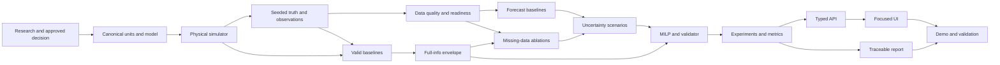

# Dependency graph and critical path

Critical path: canonical model → simulator → deterministic truth/observation → valid baseline → joint envelope → low-data and uncertainty tests → MILP/independent validation → experiment runner → report/demo. Data readiness and forecast baselines can develop in parallel after the generator; UI component design and report schema can be designed in parallel but implementation depends on stable numerical contracts. API and report rendering can begin together after experiment/result schemas settle. Blockers: missing physical convention, non-reproducible generator, truth leakage, invalid baseline, no feasible validated optimizer, or untraceable results. Real operator interviews and real data are **field claim** gates, not simulation-core blockers.
